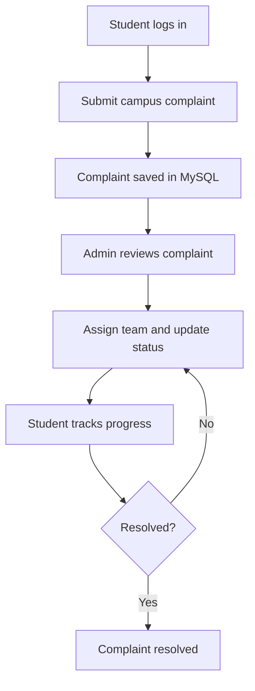

<div align="center">


# 🏫 CampusCare
### Campus Complaint Portal

**Report issues. Track progress. Build a better campus.**

A modern, responsive campus complaint management system built with **PHP, MySQL, HTML, CSS, and JavaScript**.

<p>
  
  
  
  
  
</p>

<a href="#-features">Features</a> ·
<a href="#-screens-and-workflow">Workflow</a> ·
<a href="#-getting-started">Getting Started</a> ·
<a href="#-project-structure">Structure</a> ·
<a href="#-security-notes">Security</a>

</div>

---

## ✨ About the Project

CampusCare makes it easier for students to report campus problems and follow their resolution from submission to completion. Administrators can review incoming complaints, assign teams, update statuses, and keep work organized from one place.

> 💡 **Project goal:** Make campus issue reporting transparent, trackable, and easy to use on any device.

## 🚀 Features

<table>
<tr>
<td width="50%" valign="top">

### 🎓 Student Experience
- 🔐 Student authentication
- 📝 Submit campus complaints
- 🗂️ Choose a complaint category
- 📍 Add building, room, or area details
- 🖼️ Attach an issue photo
- 🔎 Search and filter personal complaints
- 🧭 Track complaint status and timeline
- 📱 Responsive mobile-friendly interface

</td>
<td width="50%" valign="top">

### 🛠️ Admin Operations
- 📊 Dashboard with complaint statistics
- 📋 View and manage all complaints
- 🔍 Search by complaint details
- 🧰 Filter by category and status
- 👥 Assign complaints to a team/person
- 🔄 Update complaint status
- 🗒️ Add internal or resolution notes
- ✅ Follow issues through resolution

</td>
</tr>
<tr>
<td width="50%" valign="top">

### 🎨 Modern UI
- ☀️🌙 Light and dark themes
- 💾 Theme preference saved in the browser
- 🧩 Consistent cards, forms, and status badges
- 💬 Toast notifications and validation feedback
- ✨ Subtle hover and focus interactions
- ♿ Reduced-motion support

</td>
<td width="50%" valign="top">

### ⚙️ Technical
- 🐘 PHP backend
- 🐬 MySQL database
- 🛡️ Password hashing and session-based login
- 📤 Image upload support
- 🧱 Shared reusable layout components
- 🧭 Role-aware navigation
- 🖥️ Designed to run locally with XAMPP

</td>
</tr>
</table>

## 🔁 Screens and Workflow



### Complaint lifecycle

<p align="center">
  
  
  
  
</p>

1. A student submits an issue with its category, location, description, and optional image.
2. CampusCare stores the complaint in MySQL.
3. An administrator reviews the report and assigns it as needed.
4. The admin updates the status and adds relevant notes.
5. The student checks the complaint page to see the latest progress.

## 🧰 Built With

| Technology | Purpose |
|---|---|
| PHP | Server-side logic, sessions, form processing |
| MySQL | Users, complaints, assignments, and status data |
| HTML5 | Semantic page structure |
| CSS3 | Responsive design, themes, animations |
| JavaScript | Theme toggle and interface interactions |
| XAMPP | Local Apache + MySQL development environment |

## 🏁 Getting Started

### Prerequisites

- [XAMPP](https://www.apachefriends.org/) with Apache and MySQL
- A modern web browser
- A code editor such as VS Code

### Installation

1. **Clone the repository**
   ```bash
   git clone https://github.com/YOUR-USERNAME/campus-complaint-portal.git
   ```

2. **Move it into XAMPP's web directory**
   ```text
   C:\xampp\htdocs\campus-complaint-portal\
   ```

3. **Start Apache and MySQL** from the XAMPP Control Panel.

4. **Create/import the database**
   - Open `http://localhost/phpmyadmin`
   - Create a database if the supplied SQL file does not create one.
   - Import the project's `database.sql` file.

5. **Check database configuration**
   - Open the project's database configuration file (for example, `config.php`).
   - Set the local database host, database name, username, and password to match your XAMPP setup.

6. **Open CampusCare**
   ```text
   http://localhost/campus-complaint-portal/
   ```

> ℹ️ File names and configuration keys can differ by project version. Follow the included setup instructions and use the SQL file present in the repository.

## 🗂️ Project Structure

```text
campus-complaint-portal/
├── assets/
│   ├── css/              # Design system and responsive styles
│   ├── js/               # Theme and interface interactions
│   └── icons/             # Custom favicon assets (if included)
├── includes/              # Shared header, navigation, auth helpers
├── uploads/               # Uploaded complaint images
├── login.php              # Login page
├── dashboard.php          # Student dashboard
├── submit_complaint.php   # Complaint submission
├── my_complaints.php      # Student complaint list
├── complaint.php          # Complaint details and tracking
├── admin.php              # Admin dashboard
├── manage_complaints.php  # Admin complaint operations
├── database.sql           # Database schema / seed data (if included)
└── README.md
```

*The exact files and folders may vary slightly by version.*

## 🌗 Light & Dark Mode

CampusCare includes separate light and dark color palettes designed for readability. The theme control displays the current mode, and the user's selection is saved in `localStorage` so it can persist between visits in the same browser.

## 🛡️ Security Notes

Before using this project beyond a local demo:

- Change or remove all demo credentials.
- Use HTTPS in production.
- Keep database credentials outside public source control where possible.
- Validate uploaded file type and size on the server; never trust the browser-provided MIME type alone.
- Restrict uploaded file execution and serve uploads safely.
- Add CSRF protection to state-changing forms.
- Apply authorization checks on every student/admin route and complaint record.
- Use least-privilege database credentials and keep PHP/MySQL updated.

## 🧭 Roadmap

- [ ] Email notifications when complaint status changes
- [ ] Complaint priority and SLA tracking
- [ ] Department/team assignment management
- [ ] Admin activity log
- [ ] Export filtered complaints to CSV
- [ ] Optional REST API integration

## 🤝 Contributing

Contributions, suggestions, and bug reports are welcome.

1. Fork the repository.
2. Create a feature branch: `git checkout -b feature/your-feature`
3. Commit your changes: `git commit -m "Add your feature"`
4. Push the branch and open a pull request.

## 📄 License

Choose and add a license file before redistributing this project publicly. Until then, all rights remain with the repository owner.

---

<div align="center">

**Made to help campuses work better, one report at a time.** 🏫

<sub>CampusCare · Campus Complaint Portal</sub>

</div>
